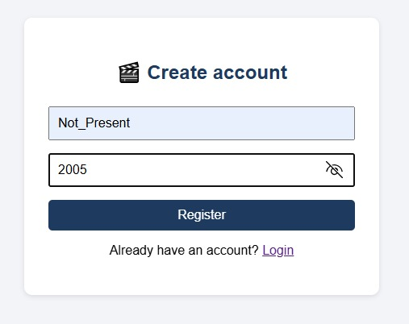
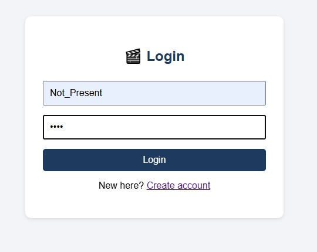
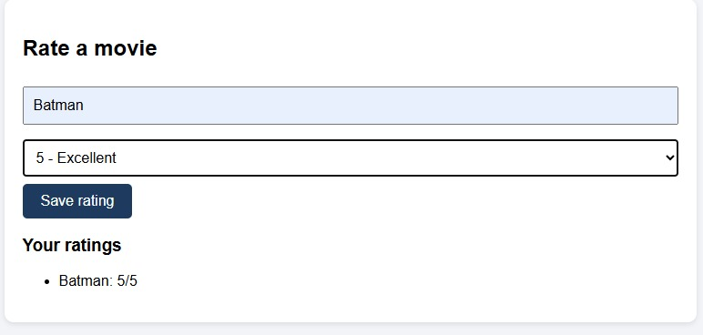
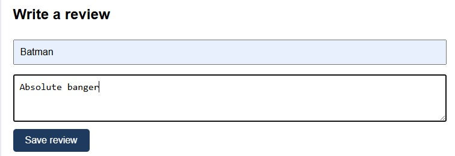
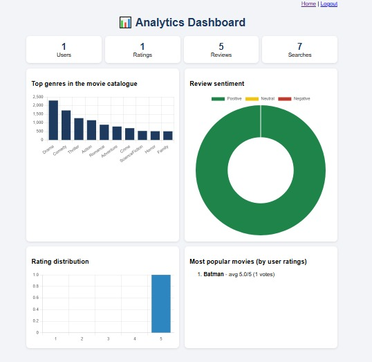
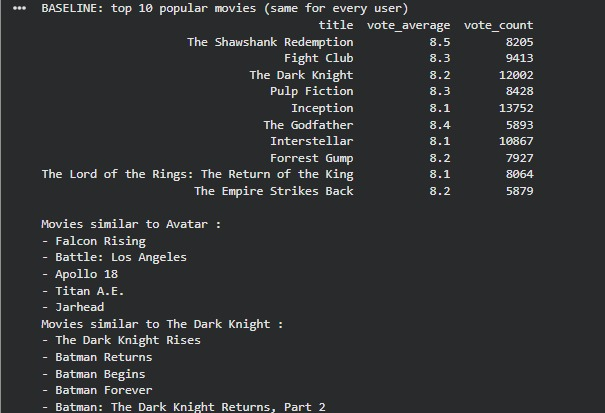
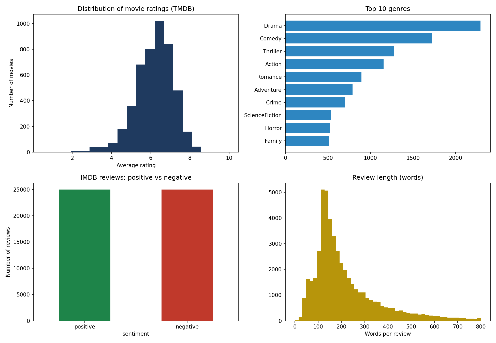

# Movie Recommendation and Review Sentiment Analysis Platform

BCA 4th Year | Academic Session 2026-2027

**Author:** Deeboleena Paul | **Roll No:** 23442723016 | **College:** Bhawanipur Global Campus

A web platform that recommends similar movies and detects whether a user's review is **Positive, Neutral or Negative**. It includes user accounts, ratings, a watchlist and an analytics dashboard.

---

## Features

- **Movie recommendation:** enter a movie name and get 5 similar movies (content-based filtering with TF-IDF and cosine similarity), each with a "why recommended" reason (shared genres and keywords).
- **Review sentiment analysis:** Logistic Regression model trained on 50,000 IMDB reviews, with extra slang and swear-word training examples. Confidence between 35% and 65% is shown as Neutral.
- **User accounts:** registration and login with hashed passwords.
- **Ratings and reviews:** users rate movies (1 to 5) and write reviews, and each review is labelled by the sentiment model.
- **Watchlist:** add and remove movies.
- **Browse by genre:** filter the catalogue by genre.
- **Dashboard:** user, rating, review and search counts, plus charts for top genres, review sentiment and rating distribution.
- **Database:** SQLite stores users, ratings, reviews, watchlist and interactions.

## Tech stack

| Area | Tools |
|---|---|
| Language | Python 3 |
| Machine learning | scikit-learn, pandas, NumPy |
| Web | Flask, HTML, CSS, Chart.js |
| Database | SQLite |
| Training environment | Google Colab |

## Datasets

Both datasets are from Kaggle and are used for academic purposes only. They are **not** included in this repository because of their size. Please download them from Kaggle and check each dataset's licence there.

1. **TMDB 5000 Movie Dataset** (by The Movie Database): about 4,800 movies with overview, genres and keywords. Used for recommendation.
2. **IMDB Dataset of 50K Movie Reviews** (by Lakshmipathi N): 25,000 positive and 25,000 negative reviews. Used for sentiment training.

## Project structure

```
movie-recommendation-sentiment/
├── app.py                 # Flask application (routes, database, ML functions)
├── recommend.ipynb        # Colab notebook: data cleaning, models, evaluation, EDA
├── requirements.txt       # Python libraries
├── eda_charts.png         # Exploratory data analysis charts
├── movies.pkl             # Cleaned movie table
├── vectors.pkl            # TF-IDF vectors of movies
├── sent_model.pkl         # Trained sentiment model
├── sent_tfidf.pkl         # TF-IDF vectorizer for reviews
├── *.jpeg                 # Screenshots of the application
└── templates/
    ├── auth.html          # Login and registration page
    ├── index.html         # Home page
    └── dashboard.html     # Analytics dashboard
```

The database file `app.db` is created automatically the first time the app runs.

## How to run

1. Install Python 3.9 or newer.
2. Download this repository (green **Code** button, then **Download ZIP**), extract it, and open a terminal (or Command Prompt) in the project folder.
3. Install the libraries:

```
pip install -r requirements.txt
```

4. Start the app:

```
python app.py
```

5. Open **http://127.0.0.1:5000** in your browser.
6. Click **Create account**, register, log in, and start exploring.

**Example movies to try:** Avatar, The Dark Knight, Titanic, Toy Story.
**Example reviews to try:** "This movie was amazing", "absolute banger", "so mid", "Very boring waste of time".

> **Note on versions:** the models were trained in Google Colab with scikit-learn 1.6.1. A newer version may print an `InconsistentVersionWarning`. It is safe to ignore, or install the same version with `pip install scikit-learn==1.6.1`.

## Methodology (short)

**Recommendation**
1. Merge the TMDB movie and credit files and keep title, overview, genres and keywords.
2. Combine them into one text field and convert it to numbers with TF-IDF.
3. Compute cosine similarity and return the 5 most similar movies.
4. A popularity baseline (weighted rating) is used for comparison.

**Sentiment analysis**
1. Clean the review text (remove HTML tags, symbols and capital letters).
2. Split the data: 32,000 train, 8,000 validation and 10,000 test reviews (random seed 42).
3. Fit TF-IDF on the training data only, to avoid data leakage.
4. Compare Logistic Regression, Linear SVM and Naive Bayes on the validation set.
5. Evaluate the best model once on the test set.
6. Add slang and swear-word examples to training, and use a Neutral zone for uncertain predictions.

## Results

| Model | Validation accuracy |
|---|---|
| **Logistic Regression** | **88.96%** |
| Linear SVM | 87.94% |
| Naive Bayes | 85.96% |

- **Test accuracy (Logistic Regression):** 88.71%, with precision, recall and F1-score of about 0.89 for both classes.
- **Final app model** (trained on all 40,000 training reviews plus slang examples): 88.9% test accuracy.
- Confusion matrix on the test set: 4,312 negative and 4,559 positive reviews correct, with 649 and 480 wrong.

## Screenshots

### Register and Login



### Movie recommendations


### Browse by genre and watchlist


### Rating and review



### Sentiment analysis


### Dashboard


### Model comparison


### Popularity baseline


### Exploratory data analysis


## Limitations

- TMDB has no user ratings, so collaborative filtering and Precision@K were not possible. The recommender was compared with a popularity baseline instead.
- The sentiment model only knows the slang it was trained on, and it can struggle with sarcasm.
- Movie search needs the exact title.
- The app runs locally with Flask's development server and is not production-ready.

## Future work

- Use MovieLens ratings to build a hybrid recommender and measure Precision@K and Recall@K.
- Use a transformer model such as BERT for better slang and sarcasm handling.
- Add fuzzy search and movie posters through the TMDB API.
- Deploy the app online.

## Acknowledgements

- Datasets: The Movie Database (TMDB) and the IMDB reviews dataset, both via Kaggle.
- Libraries: Flask, scikit-learn, pandas, NumPy and Chart.js.
- Developed as a BCA 4th Year project (Academic Session 2026-2027).

## Licence

This project is for educational purposes. Datasets remain under their original licences.
